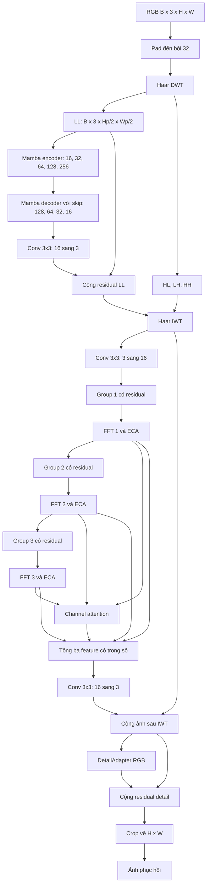

# LightWaveDehaze: đặc tả kiến trúc

LightWaveDehaze phục hồi ảnh có sương mù bằng nhánh wavelet–Mamba đa tỉ lệ, mạng tăng cường chi tiết và các residual adapter nhẹ. Tài liệu trình bày cấu trúc từ đầu vào đến đầu ra, kèm kích thước tensor, công thức, code và cách lắp ráp mạng.

Các đoạn code có `self` minh họa phương thức bên trong module tương ứng. Ví dụ lắp ráp ở mục 12 sử dụng implementation hiện có trong repo. Tên lớp và tên file trong các liên kết là định danh kỹ thuật của implementation.

## 1. Bài toán và cấu hình model

Input là ảnh RGB có sương mù `X ∈ R[B,3,H,W]`, số thực trên thang `[0,1]`. Output là ảnh phục hồi `Y` cùng shape. Mạng gồm:

1. Nhánh wavelet–Mamba phục hồi thành phần tần số thấp.
2. Mạng DEN gọn hiệu chỉnh ảnh ở độ phân giải đầy đủ.
3. Các residual adapter nhẹ trong DEN và ở đầu ra RGB.

| Tham số | Giá trị | Vai trò |
|---|---|---|
| Input/output channels | 3 | RGB |
| `wf` | 16 | Kênh ban đầu của trunk |
| Kênh encoder | 16, 32, 64, 128, 256 | Năm mức đặc trưng |
| `n_l_blocks` | `[1,2,2,4]` | Số LFSSBlock, ánh xạ theo bảng ở mục 5 |
| SS2D | `d_state=16, expand=2, d_conv=3` | Selective scan bốn hướng |
| DEN | 3 group, 16 kênh | Hiệu chỉnh ảnh sau IWT |
| `depth=d` | 1 hoặc 2 | Số DEN Block trong mỗi group |
| FeatureAdapter | `16→32→16`, DWConv5×5 | Hiệu chỉnh feature |
| DetailAdapter | `3→16→3`, DWConv3×3 | Hiệu chỉnh ảnh RGB |
| Padding | Bội số 32 | Phù hợp một DWT ngoài và bốn downsample trong trunk |

### Hai cấu hình độ sâu

| Cấu hình | `depth` | DEN Block toàn mạng | Tổng tham số |
|---|---:|---:|---:|
| LightWaveDehaze, một block/group | 1 | 3 | 6.506.962 |
| LightWaveDehaze, hai block/group | 2 | 6 | 7.457.650 |

Mỗi cấu hình có ba group nối tiếp, mỗi group chứa `depth` DEN Block. Các module còn lại có cùng cấu trúc và số kênh.

## 2. Sơ đồ và công thức toàn mạng



Các group và FFT chạy nối tiếp. Fusion mới sử dụng đồng thời feature của ba mức.

```text
Hp = 32 ceil(H/32), Wp = 32 ceil(W/32)
Xp                  = Pad32(X)
(LL, HL, LH, HH)     = DWT(Xp)
LL_hat              = LL + MambaTrunk(LL)
Z                   = IWT(LL_hat, HL, LH, HH)
Q                   = DEN(Z)
Yp                  = Q + DetailAdapter(Q)
Y                   = Yp[:, :, :H, :W]
```

`DEN(Z)` đã có residual `+Z`. Không cộng ảnh trung gian hai lần. Toàn mạng không có sigmoid/clamp đầu ra; clamp khi tính metric/xuất ảnh là thao tác riêng.

## 3. Bước 1: pad ảnh đến bội 32

Nguồn: [`phase4_data.py`, hàm `pad32`](phase4_data.py).

```python
import torch
import torch.nn as nn
import torch.nn.functional as F


def pad32(x):
    h, w = x.shape[-2:]
    dh, dw = (-h) % 32, (-w) % 32
    mode = 'reflect' if dh < h and dw < w else 'replicate'
    return F.pad(x, (0, dw, 0, dh), mode=mode)
```

Chỉ thêm pixel bên phải/phía dưới, không resize. Ví dụ `257×321 → 288×352`, cuối mạng crop lại. Reflection padding chuyển sang replicate khi ảnh quá nhỏ. `eval_max_side` là resize của pipeline dữ liệu, không thuộc kiến trúc.

## 4. Bước 2: Haar DWT ngoài trunk

Nguồn: [`wavelet.py`, `dwt_init` và `DWT`](../basicsr/archs/wavelet.py).

DWT tạo bốn dải ở nửa kích thước mỗi chiều. Implementation ngoài trunk ghép theo **batch**:

```python
def dwt_init(x):
    x01 = x[:, :, 0::2, :] / 2
    x02 = x[:, :, 1::2, :] / 2
    x1 = x01[:, :, :, 0::2]
    x2 = x02[:, :, :, 0::2]
    x3 = x01[:, :, :, 1::2]
    x4 = x02[:, :, :, 1::2]
    ll = x1 + x2 + x3 + x4
    hl = -x1 - x2 + x3 + x4
    lh = -x1 + x2 - x3 + x4
    hh = x1 - x2 - x3 + x4
    return torch.cat((ll, hl, lh, hh), dim=0)


# Trích UNet.forward; DWT/IWT từ basicsr.archs.wavelet.
batch = x.shape[0]
x_dwt = DWT()(x)           # [4B,3,Hp/2,Wp/2]
x_ll = x_dwt[:batch]       # [B,3,Hp/2,Wp/2]
x_high = x_dwt[batch:]     # [3B,3,Hp/2,Wp/2]
```

Chỉ LL đi vào Mamba trunk. Các dải cao tần được giữ đến IWT; ảnh sau đó vẫn được DEN và adapter hiệu chỉnh.

## 5. Bước 3: encoder–decoder Mamba trên LL

Nguồn: [`wavemamba_arch.py`](../basicsr/archs/wavemamba_arch.py), `UNet`, `Down_wt`, `UNetUpBlock`, `MambaBlock`.

### 5.1. Shape và số block từng mức

| Mức | Phép xử lý | Shape đầu ra | LFSSBlock |
|---|---|---|---:|
| E0 | Conv3×3 `3→16`, Mamba | `[B,16,Hp/2,Wp/2]` | 1 |
| E1 | Wavelet downsample `16→32`, Mamba | `[B,32,Hp/4,Wp/4]` | 1 |
| E2 | Wavelet downsample `32→64`, Mamba | `[B,64,Hp/8,Wp/8]` | 2 |
| E3 | Wavelet downsample `64→128`, Mamba | `[B,128,Hp/16,Wp/16]` | 2 |
| E4 | Wavelet downsample `128→256`, Mamba | `[B,256,Hp/32,Wp/32]` | 4 |
| D3 | Upsample, skip E3, Mamba | `[B,128,Hp/16,Wp/16]` | 4 |
| D2 | Upsample, skip E2, Mamba | `[B,64,Hp/8,Wp/8]` | 2 |
| D1 | Upsample, skip E1, Mamba | `[B,32,Hp/4,Wp/4]` | 2 |
| D0 | Upsample, skip E0, Mamba | `[B,16,Hp/2,Wp/2]` | 1 |
| LL residual | Conv3×3 `16→3`, cộng LL | `[B,3,Hp/2,Wp/2]` | — |

Tổng cộng **19 LFSSBlock**. Danh sách `[1,2,2,4]` không phải bốn mức encoder: E0/E1 cùng dùng phần tử đầu. Một số channel trong implementation viết cố định nên đổi `wf` đơn lẻ chưa đủ để thay độ rộng mạng.

### 5.2. Downsample bằng wavelet

Khác DWT ngoài, `Down_wt` ghép bốn dải theo **channel**, rồi `Conv1×1 + BN + ReLU` đưa `4Cin` về `Cout`:

```python
from pytorch_wavelets import DWTForward


class Down_wt(nn.Module):
    def __init__(self, in_ch, out_ch):
        super().__init__()
        self.wt = DWTForward(J=1, mode='zero', wave='haar')
        self.conv_bn_relu = nn.Sequential(
            nn.Conv2d(in_ch * 4, out_ch, 1),
            nn.BatchNorm2d(out_ch),
            nn.ReLU(inplace=True),
        )

    def forward(self, x):
        yl, yh = self.wt(x)
        hl = yh[0][:, :, 0, :, :]
        lh = yh[0][:, :, 1, :, :]
        hh = yh[0][:, :, 2, :, :]
        return self.conv_bn_relu(torch.cat([yl, hl, lh, hh], dim=1))
```

### 5.3. Upsample và skip connection

Mỗi decoder stage dùng transpose convolution, concat skip rồi convolution:

```python
# Trong UNetUpBlock.__init__:
self.up = nn.ConvTranspose2d(in_chans, out_chans, 2, stride=2)
self.conv_block = nn.Sequential(
    nn.Conv2d(2 * out_chans, out_chans, 3, padding=1),
    nn.ReLU(inplace=True),
)

# Trong UNetUpBlock.forward:
up = self.up(x)
dh = bridge.size(2) - up.size(2)
dw = bridge.size(3) - up.size(3)
up = F.pad(up, [dw // 2, dw - dw // 2, dh // 2, dh - dh // 2])
out = self.conv_block(torch.cat([up, bridge], dim=1))
```

### 5.4. Forward LL hoàn chỉnh

Đổi tên biến cho dễ theo dõi, dùng đúng module hiện có:

```python
# Trong UNet.forward:
e0 = self.down_group0(self.layer0(x_ll))
e1 = self.down_group1(self.layer1(e0))
e2 = self.down_group2(self.layer2(e1))
e3 = self.down_group3(self.layer3(e2))
e4 = self.down_group4(self.layer4(e3))
d3 = self.up_group4(self.layer_3(e4, e3))
d2 = self.up_group3(self.layer_2(d3, e2))
d1 = self.up_group2(self.layer_1(d2, e1))
d0 = self.up_group1(self.layer_0(d1, e0))
output_ll = x_ll + self.last(d0)
```

## 6. Bước 4: bên trong MambaBlock

Các đoạn dùng `self` dưới đây là trích phương thức, không phải script hoặc lớp thay thế độc lập. Dùng implementation ở `wavemamba_arch.py` để giữ đầy đủ initializer và tham số state-space.

### 6.1. MambaBlock: ảnh thành token

```python
class MambaBlock(nn.Module):
    def __init__(self, dim, n_l_blocks=1, expand=2):
        super().__init__()
        self.l_blk = nn.Sequential(
            *[LFSSBlock(dim) for _ in range(n_l_blocks)]
        )

    def forward(self, x_ll):
        b, c, h, w = x_ll.shape
        tokens = x_ll.flatten(2).transpose(1, 2).contiguous()
        for layer in self.l_blk:
            tokens = layer(tokens, [h, w])
        return tokens.transpose(1, 2).reshape(b, c, h, w).contiguous()
```

Đối số `expand` của MambaBlock hiện chưa truyền tiếp xuống LFSSBlock. SS2D sử dụng hệ số mở rộng mặc định `expand=2` trong cấu hình này.

### 6.2. LFSSBlock: hai residual

```text
U = X * skip_scale  + DropPath(SS2D(LayerNorm(X)))
V = U * skip_scale2 + FFN(LayerNorm(U))
```

```python
# LFSSBlock.forward:
b, length, c = tokens.shape
x = tokens.view(b, *x_size, c).contiguous()
u = x * self.skip_scale + self.drop_path(
    self.self_attention(self.ln_1(x))
)
v = self.conv_blk(
    self.ln_2(u).permute(0, 3, 1, 2).contiguous()
).permute(0, 2, 3, 1).contiguous()
return (u * self.skip_scale2 + v).view(b, -1, c).contiguous()
```

Hai vector skip theo channel học được, khởi tạo bằng 1. DropPath mặc định hiện tại bằng 0.

### 6.3. SS2D: selective scan bốn hướng

Với `C` kênh: `d_inner=2C`, `d_state=16`, `dt_rank=ceil(C/16)`.

1. `Linear(C→4C)` tách feature `x` và gate `z`, mỗi nhánh `2C`.
2. Feature qua depthwise 3×3 và SiLU.
3. Tạo chuỗi row-major/column-major, mỗi chuỗi có chiều thuận và ngược.
4. Projection tạo tham số phụ thuộc input; gọi `selective_scan_fn`.
5. Đưa bốn kết quả về cùng tọa độ, cộng, LayerNorm, nhân `SiLU(z)`.
6. `Linear(2C→C)` trả về số kênh ban đầu.

```python
# Đầu SS2D.forward_core:
b, c, h, w = x.shape
length = h * w
row_col = torch.stack([
    x.view(b, -1, length),
    x.transpose(2, 3).contiguous().view(b, -1, length),
], dim=1).view(b, 2, -1, length)
xs = torch.cat([row_col, row_col.flip(-1)], dim=1)
# [B,4,d_inner,H*W]
```

Projection và scan dùng tham số đã khai báo trong SS2D:

```python
# Phần tiếp theo trong forward_core:
x_dbl = torch.einsum('b k d l, k c d -> b k c l', xs, self.x_proj_weight)
dts, bs, cs = torch.split(
    x_dbl, [self.dt_rank, self.d_state, self.d_state], dim=2)
dts = torch.einsum('b k r l, k d r -> b k d l', dts, self.dt_projs_weight)
out_y = self.selective_scan(
    xs.float().reshape(b, -1, length),
    dts.contiguous().float().reshape(b, -1, length),
    -torch.exp(self.A_logs.float()).reshape(-1, self.d_state),
    bs.float().reshape(b, 4, -1, length),
    cs.float().reshape(b, 4, -1, length),
    self.Ds.float().reshape(-1),
    z=None, delta_bias=self.dt_projs_bias.float().reshape(-1),
    delta_softplus=True, return_last_state=False,
).view(b, 4, -1, length)
```

`forward_core` đảo chuỗi/quay lại trục không gian đúng vị trí trước khi trả bốn kết quả. Không cộng trực tiếp các chuỗi chưa căn chỉnh. `A=-exp(A_logs)`; initializer riêng cho delta nằm trong `SS2D.dt_init`. Scan được cast FP32 trong code hiện tại.

```python
# SS2D.forward:
b, h, w, c = x.shape
x, z = self.in_proj(x).chunk(2, dim=-1)
x = self.act(self.conv2d(x.permute(0, 3, 1, 2).contiguous()))
y1, y2, y3, y4 = self.forward_core(x)
y = (y1 + y2 + y3 + y4).transpose(1, 2).contiguous()
y = y.view(b, h, w, -1)
y = self.out_norm(y) * F.silu(z)
out = self.out_proj(y)
if self.dropout is not None:
    out = self.dropout(out)
return out
```

### 6.4. FFN gate và ECA

```python
# ffn.forward:
x = self.conv2(self.conv1(x))       # 1x1 C→2C, DW3x3
x1, x2 = x.chunk(2, dim=1)
x = self.activation(x1) * x2        # GELU gate
if self.use_attention:
    x = self.eca(x)
return self.conv3(x)                # 1x1 C→C
```

ECA dùng global average pooling → Conv1d kernel 3 theo channel → sigmoid → nhân lại feature. Không có ma trận attention token–token.

## 7. Bước 5: Haar IWT tái tạo ảnh trung gian

```python
# Trong UNet.forward:
x_stage1 = IWT()(torch.cat((output_ll, x_high), dim=0))
# [4B,3,Hp/2,Wp/2] → [B,3,Hp,Wp]
```

Nguồn: [`wavelet.py`, `iwt_init`](../basicsr/archs/wavelet.py). Phép dựng bốn vị trí mỗi ô 2×2:

```python
ll, hl, lh, hh = [part / 2 for part in x.chunk(4, dim=0)]
out = torch.zeros(
    ll.shape[0], ll.shape[1], 2*ll.shape[2], 2*ll.shape[3],
    device=x.device, dtype=torch.float32,
)
out[:, :, 0::2, 0::2] = ll - hl - lh + hh
out[:, :, 1::2, 0::2] = ll - hl + lh - hh
out[:, :, 0::2, 1::2] = ll + hl - lh - hh
out[:, :, 1::2, 1::2] = ll + hl + lh + hh
```

IWT hiện tạo output FP32. `x_stage1` chưa phải ảnh đầu ra cuối.

## 8. Bước 6: DEN gọn với U-Net con

Nguồn: [`detail_enhance_net.py`](../basicsr/archs/detail_enhance_net.py), [`Ublock.py`](../basicsr/archs/Ublock.py), [`phase4_arch.py`](phase4_arch.py).

### 8.1. Ba group

`Conv3×3(3→16)` tạo F0. Từng group gồm `d` DEN Block, FeatureAdapter, terminal Conv3×3 rồi cộng input group:

```text
Group_i(F) = F + Conv3×3(FeatureAdapter(Block_d(...Block_1(F))))
F1 = FFT_1(Group_1(F0))
F2 = FFT_2(Group_2(F1))
F3 = FFT_3(Group_3(F2))
```

Mọi F0..F3 có `[B,16,Hp,Wp]`. FeatureAdapter nằm trong group, trước terminal convolution. Group forward hiện có:

```python
def forward(self, x):
    return self.gp(x) + x
```

### 8.2. Một DEN Block

Một DEN Block gồm hai convolution và một U-Net con:

```python
# Block.__init__:
self.conv1 = nn.Conv2d(16, 16, 3, padding=1)
self.act1 = nn.ReLU(inplace=True)
self.conv2 = nn.Conv2d(16, 16, 3, padding=1)
self.ublock = unetBlock(dim=16)

# Block.forward:
res = self.act1(self.conv1(x))
res = res + x
res = self.conv2(res)
res = self.ublock(res)
return res + x
```

### 8.3. U-Net con

Ba downsample dùng Conv4×4, stride 2, padding 1 và ReLU: `16→32→64→128`. Decoder transpose-conv + concat skip + Conv3×3 + ReLU, đi ngược về 16 kênh. U-Net con có residual riêng:

```python
# unetBlock.forward:
e0 = x                              # [B,16,Hp,Wp]
e1 = self.layer1(e0)                 # [B,32,Hp/2,Wp/2]
e2 = self.layer2(e1)                 # [B,64,Hp/4,Wp/4]
e3 = self.layer3(e2)                 # [B,128,Hp/8,Wp/8]
d2 = self.layer_2(e3, e2)
d1 = self.layer_1(d2, e1)
d0 = self.layer_0(d1, e0)
return d0 + x
```

Mỗi DEN Block chứa một encoder–decoder con. Số block trong group quyết định độ sâu và phần lớn chi phí tính toán của DEN.

## 9. Bước 7: FeatureAdapter

Nguồn: [`phase4_arch.py`, `FeatureAdapter`](phase4_arch.py).

```python
class FeatureAdapter(nn.Module):
    def __init__(self, channels=16):
        super().__init__()
        self.body = nn.Sequential(
            nn.Conv2d(channels, 2*channels, 1),
            nn.SiLU(),
            nn.Conv2d(2*channels, 2*channels, 5,
                      padding=2, groups=2*channels),
            nn.SiLU(),
            nn.Conv2d(2*channels, channels, 1),
        )
        nn.init.zeros_(self.body[-1].weight)
        nn.init.zeros_(self.body[-1].bias)

    def forward(self, x):
        return x + self.body(x)
```

Mỗi adapter có 1.904 tham số ở 16 kênh; ba adapter có 5.712 tham số. Conv cuối khởi tạo bằng 0 khiến FeatureAdapter là ánh xạ identity ở thời điểm khởi tạo.

## 10. Bước 8: FFT và fusion ba mức

### 10.1. FFT block

Nguồn: [`detail_enhance_net.py`, `fft_bench`](../basicsr/archs/detail_enhance_net.py). Nhánh không gian Conv3×3 cộng với nhánh FFT:

```python
def forward(self, x):
    _, _, h, w = x.shape
    freq = torch.fft.rfft2(x, norm='backward')
    mag, pha = torch.abs(freq), torch.angle(freq)
    pha_eca = self.eca(pha)
    mag_out = self.mag(mag)                 # Conv1x1:16→16
    weights = F.adaptive_avg_pool2d(mag_out, (1, 1))
    weights = F.softmax(weights, dim=1)
    pha_out = pha + self.pha(pha_eca * weights)
    # self.pha: Conv1x1 → ReLU → Conv1x1, 16 kênh.
    freq_out = torch.complex(
        mag_out * torch.cos(pha_out), mag_out * torch.sin(pha_out))
    y = torch.fft.irfft2(freq_out, s=(h, w), norm='backward')
    return self.main(x) + y
```

Tensor tần số có `[B,16,Hp,floor(Wp/2)+1]`. `mag_out` sau convolution không bị ép dương; không mô tả nó thành biên độ không âm đã ràng buộc.

### 10.2. Channel attention fusion

Ghép ba feature thành 48 kênh. `self.ca` dùng GAP → Conv1×1(48→4) → ReLU → Conv1×1(4→48) → sigmoid:

```python
weights = self.ca(torch.cat([res1, res2, res3], dim=1))
weights = weights.view(-1, 3, 16, 1, 1)
fused = (weights[:, 0] * res1
         + weights[:, 1] * res2
         + weights[:, 2] * res3)
q = self.post(fused) + x_stage1             # Conv3x3:16→3
```

Đây là tổng có trọng số sigmoid, không phải trung bình hay softmax trên ba group. ECA trong FFT và attention fusion là hai cơ chế khác nhau.

## 11. Bước 9: DetailAdapter RGB và crop

Nguồn: [`phase4_arch.py`, `DetailAdapter` và `PaddedModel`](phase4_arch.py).

```python
class DetailAdapter(nn.Module):
    def __init__(self, width=16):
        super().__init__()
        self.body = nn.Sequential(
            nn.Conv2d(3, width, 1), nn.SiLU(),
            nn.Conv2d(width, width, 3, padding=1, groups=width),
            nn.SiLU(), nn.Conv2d(width, 3, 1),
        )
        nn.init.zeros_(self.body[-1].weight)
        nn.init.zeros_(self.body[-1].bias)

    def forward(self, x):
        return self.body(x)
```

Ở `width=16`, adapter có 275 tham số, trả về delta RGB. Wrapper cộng delta một lần rồi crop:

```python
class PaddedModel(nn.Module):
    def __init__(self, trunk, spec, adapter=None):
        super().__init__()
        self.trunk, self.adapter, self.spec = trunk, adapter, spec

    def forward(self, x):
        h, w = x.shape[-2:]
        y = self.trunk(pad32(x))
        if isinstance(y, (tuple, list)):
            y = y[-1]
        if self.adapter is not None:
            y = y + self.adapter(y)
        return y[..., :h, :w]
```

Khi trunk trả tuple `(output_LL,x_stage1,x_final)`, wrapper lấy phần tử cuối. Khi trunk trả tensor trực tiếp, wrapper sử dụng tensor đó.

Tổng adapter có 5.987 tham số. Các convolution trong adapter tốn khoảng 0,748683264 GFLOPs ở 256×256 theo quy ước 1 MAC = 2 FLOPs, chưa gồm activation và cộng residual.

## 12. Lắp ráp LightWaveDehaze

Ví dụ chạy trong môi trường phase 4 đã cài PyTorch CUDA, mamba_ssm, pytorch_wavelets và dependency của notebook. Chạy process sạch vì `import_architecture` quản lý namespace basicsr. Đổi đường dẫn theo máy/Colab.

```python
from pathlib import Path
import sys
import torch

REPO_ROOT = Path('/content/LightWaveDehaze')
sys.path.insert(0, str(REPO_ROOT / 'phase 4'))
import phase4_arch as arch

torch.manual_seed(2040)
spec = {
    'kind': 'final',
    'depth': 2,                 # Chọn 1 hoặc 2 block/group.
    'feature_adapter': True,
    'detail_width': 16,
}
model = arch.skeleton(str(REPO_ROOT), spec)
print('Params:', sum(p.numel() for p in model.parameters()))
# depth=2: 7_457_650; depth=1: 6_506_962.
model = model.to('cuda').eval()
with torch.inference_mode():
    x = torch.rand(1, 3, 257, 321, device='cuda')
    y = model(x)
assert y.shape == x.shape
print('Output:', tuple(y.shape))
```

Phần lắp ráp trong `skeleton`:

```python
trunk = new_trunk(repo_root, spec['depth'])
for name in ('g1', 'g2', 'g3'):
    group = getattr(trunk.restoration_network.DE, name)
    terminal = group.gp[-1]
    blocks = list(group.gp[:spec['depth']])
    group.gp = nn.Sequential(
        *blocks, FeatureAdapter(terminal.in_channels), terminal)
model = PaddedModel(trunk, dict(spec), DetailAdapter(spec['detail_width']))
```

`new_trunk` tạo trunk với `in_chn=3`, `wf=16`, `n_l_blocks=[1,2,2,4]`, `ffn_scale=2`, rồi đặt `DENet(3,depth)`. Conv/Linear dùng initializer mặc định, SS2D có initializer riêng và conv cuối adapter dùng zero-init. Ví dụ trên tạo toàn bộ graph và kiểm tra shape đầu ra.

## 13. Kiểm tra cấu trúc

1. Input/output cùng `[B,3,H,W]`, kể cả H/W không chia hết cho 32.
2. DWT ngoài ghép theo batch; wavelet downsample trong encoder ghép theo channel.
3. Trunk có 19 LFSSBlock; DEN có `3 × depth` Block.
4. Mỗi group có một FeatureAdapter trước terminal convolution.
5. Các residual của group, DEN Block và U-Net con là những đường riêng.
6. DEN đã cộng ảnh trung gian; wrapper chỉ cộng DetailAdapter RGB một lần.
7. `depth=1` có 6.506.962 tham số; `depth=2` có 7.457.650 tham số.

## 14. Bản đồ implementation

| File | Module kiến trúc |
|---|---|
| [`phase4_arch.py`](phase4_arch.py) | FeatureAdapter, DetailAdapter, PaddedModel, new_trunk, skeleton |
| [`wavemamba_arch.py`](../basicsr/archs/wavemamba_arch.py) | Trunk encoder–decoder, MambaBlock, LFSSBlock, SS2D, FFN |
| [`wavelet.py`](../basicsr/archs/wavelet.py) | DWT/IWT ngoài trunk |
| [`detail_enhance_net.py`](../basicsr/archs/detail_enhance_net.py) | DENet, Group, Block, FFT, ECA |
| [`Ublock.py`](../basicsr/archs/Ublock.py) | U-Net con trong DEN Block |
| [`phase4_data.py`](phase4_data.py) | Padding đầu vào |
