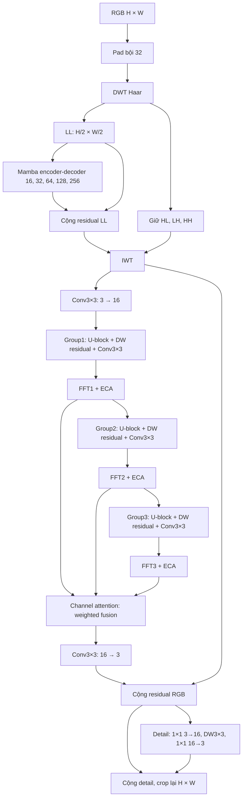

# Kiến trúc cuối Phase 4: WaveLite-Final



WaveMamba giữ `wf=16`, `n_l_blocks=[1,2,2,4]`, FFN scale2 và toàn bộ cấu trúc LL gốc.
Sơ đồ trên mô tả quick một block. Standard giữ hai U-block/group (chỉ số 0 và 1), cả hai nhận
nguyên trọng số checkpoint. Trunk, terminal conv, FFT và attention cũng kế thừa trực tiếp;
checkpoint đầy đủ tiếp tục làm teacher. Không trung bình trọng số các block phi tuyến.
U-block giữ nguyên cấu trúc/checkpoint; group-terminal conv, FFT, ECA, pre/post và channel
attention đều giữ. Quick giữ block 0, tương thích Phase3 một block. Standard cần checkpoint
đầy đủ để lấy block 0 và 1; nếu student chỉ có một block thì dùng teacher đầy đủ.

Mỗi depthwise residual ở group có:

```text
x + Conv1×1(32→16)(SiLU(DWConv5×5(SiLU(Conv1×1(16→32)(x)))))
```

Conv cuối khởi tạo bằng 0. Detail adapter RGB cũng có conv cuối bằng 0. Khi nguồn là
Phase3 một U-block/group, output lúc khởi tạo giữ nguyên (trong sai số số học).
Không dùng identity-init để tuyên bố đã phục hồi PSNR: chỉ validation và test cuối xác nhận.

Ba feature adapter thêm 5.712 tham số; detail adapter thêm 275, tổng thêm **5.987 tham số**
so với Fast-WDMamba một block. Theo baseline 6.500.975 tham số đã đo ở Phase3, eager model
dự kiến có 6.506.962 tham số. Counted FLOPs của các adapter là 0,748683264 GFLOPs tại256²,
chưa gồm activation/cộng residual. Runner sẽ xuất số đếm thực tế toàn mạng.

So với WDMamba bốn/sáu U-block/group, phần DEN giảm số U-block nặng còn ba (quick) hoặc sáu (standard) tổng cộng.
So với Fast-WDMamba Phase3, đây là thêm năng lực phục hồi với chi phí nhỏ; bản thân adapter
không làm model nhanh hơn Phase3. Tăng tốc runtime còn phụ thuộc fusion và GPU. Nếu tham
chiếu hiện có chỉ là Phase3, điều kiện tăng FPS2× có thể không đạt và report phải là REVIEW.

Đường huấn luyện O-HAZY/RESIDE/ITS/OTS có train/val: khởi tạo từ checkpoint phù hợp, tối ưu
DEN/detail rồi joint; loss GT + teacher regularization và best EMA theo validation.
I-HAZE: final và reference khởi tạo ngẫu nhiên độc lập, GT loss, không KD/truyền trọng số.

SOTS luôn giữ ảnh benchmark làm test. Khi không có ITS/OTS train riêng, notebook tự dùng
RESIDE-6K/train tách khỏi test để phục hồi model compact; có thể thay bằng `TRAIN_ROOT` riêng.
Nếu không có train/val, `REQUIRE_COMPRESSION=True` dừng trước benchmark thay vì ghi bản sao
Reference thành WaveLite. Artifact ghi `compression` và `model_spec` để kiểm tra kiến trúc thực đo.
